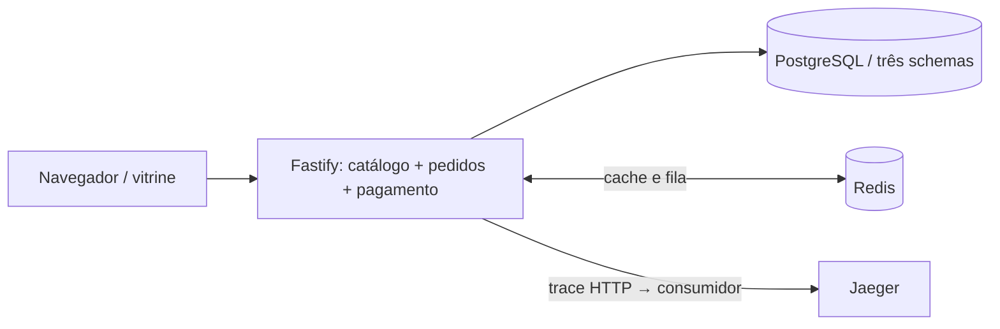
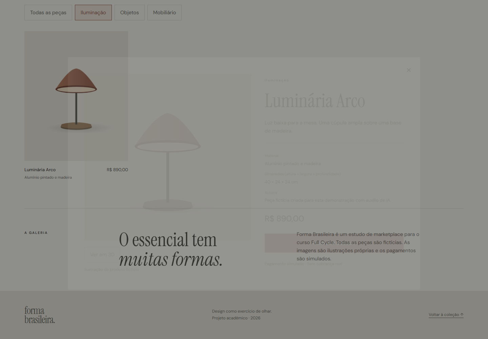
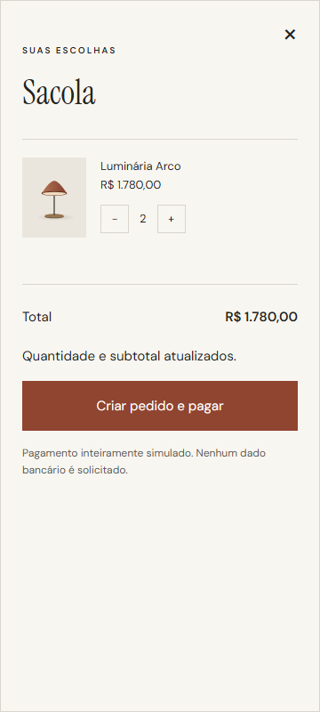

# Projeto A · Forma Brasileira

> Marketplace modular de objetos de design brasileiro — trabalho final do curso Full Cycle.

[](src/)
[](docs/openapi.yaml)
[](https://github.com/PedroGiffoni/EngFullCycle-Marketplace/actions/workflows/ci.yml)

**Forma Brasileira** é uma galeria comercial demonstrativa: explore a coleção, veja a luminária em 3D, monte a sacola, crie um pedido e confirme um pagamento simulado. Todos os produtos são fictícios. Os objetos nas imagens são ilustrações próprias, sem atribuição a designers reais.

**Online, sem login:** [abrir na Vercel](https://forma-brasileira.vercel.app) · [alternativa no Render](https://forma-brasileira-api-7fo6.onrender.com). API e Redis no Render, PostgreSQL no Supabase, em planos gratuitos. A API pode demorar a retomar na primeira visita. [Publicação e evidências](docs/publicacao.md).

<!-- Screenshot real gerado pelo Playwright contra API + PostgreSQL + Redis. -->


## Navegação

[Proposta](#proposta-e-fluxo) · [Stack](#stack-e-arquitetura) · [Executar](#executar) · [API](#api) · [Verificar](#verificar) · [Evidências](#evidências-e-status) · [Publicação](#publicação-e-limites) · [Defesa](#documentação-e-defesa)

## Proposta e fluxo

- Catálogo e filtros alimentados por API e PostgreSQL reais.
- Detalhe com material, dimensões e preço; Three.js carregado somente ao ativar **Ver em 3D** na Luminária Arco.
- Sacola com quantidades, consulta ao preço atual e feedback de erro.
- Pedido com total calculado no servidor e preço congelado por item.
- Pagamento simulado assíncrono, com unicidade no banco e reentrega idempotente.
- Layout responsivo, teclado, Escape, anúncios de estado e movimento reduzido.

O público é o avaliador e quem deseja estudar uma fatia completa de marketplace. Não há cobrança financeira, estoque, frete ou comércio ativo.

## Stack e arquitetura

| Camada | Implementação |
|---|---|
| API | Node 24, TypeScript, Fastify |
| Persistência | PostgreSQL 17, SQL explícito, Repository |
| Cache / fila | Redis 7, BullMQ, Strategy de pagamento simulado |
| Interface | Vite, TypeScript, CSS, Motion, Three.js sob demanda |
| Qualidade | ESLint, TypeScript, Redocly, Vitest + v8, AJV 2020, Playwright, npm audit |
| Operação | Docker Compose, logs JSON, prom-client, OpenTelemetry, Jaeger |



Um único processo executa HTTP e consumidor. Interfaces públicas separam módulos; cada módulo controla suas tabelas. [ADR](docs/adr/0001-decisao.md) · [C4 contexto](docs/c4/contexto.md) · [C4 contêineres](docs/c4/containers.md).

## Executar

Pré-requisitos: Docker Desktop ativo, Docker Compose v2 com suporte a `!override` para homologação; Node 24 + npm para ferramentas locais. Portas padrão: app 3000, PostgreSQL **55432**, Redis 6379, Jaeger 16686/4318.

```sh
git clone https://github.com/PedroGiffoni/EngFullCycle-Marketplace.git
cd EngFullCycle-Marketplace
docker compose up --build -d --wait
```

Abra [a galeria local](http://localhost:3000). O app espera PostgreSQL/Redis saudáveis, aplica migrações e carrega quatro peças. O volume de 100 mil pedidos é um comando explícito:

```sh
docker compose exec app npm run seed
docker compose exec app npm run verify:seed
# Repita os dois comandos: os 100 mil pedidos e itens não devem duplicar.
```

Para desenvolvimento local, com as dependências Docker ativas:

```sh
npm ci
npm run build
npm start
```

Não execute `npm start` local junto do app Docker na mesma porta. `npm run dev` reinicia o servidor em mudanças; o frontend precisa de novo `npm run build`. Configuração em [.env.example](.env.example): exemplos locais, sem credenciais de produção. O app lê variáveis do processo; para carregar arquivo use `node --env-file=.env --import tsx src/server.ts`. `.env` está ignorado.

Homologação isolada (outro projeto Compose, volume e portas):

```sh
docker compose -f docker-compose.yml -f compose.homolog.yml up --build -d --wait
# http://localhost:3001 ; banco 5433 ; Redis 6380 ; Jaeger 16687
```

## API

| Método | Rota | Uso |
|---|---|---|
| GET | `/api/products?category=Objetos` | Listar e filtrar |
| GET | `/api/products/luminaria-arco` | Detalhar |
| POST | `/api/orders` | Criar `{ "items": [{ "productId": "vaso-terra", "quantity": 1 }] }` |
| GET | `/api/orders/{uuid}` | Consultar pedido |
| POST | `/api/orders/{uuid}/payments` | Enviar `{}`; retorna 202, ou 200 se já pago |
| GET | `/health`, `/ready`, `/metrics` | Vida, banco e métricas |

Contrato completo com exemplos e erros: [OpenAPI 3.1](docs/openapi.yaml). Nunca enviar total: o servidor rejeita campos extras. Consultar o pedido até `paid`; 202 significa aceitação, não confirmação.

## Verificar

Com PostgreSQL e Redis ativos:

```sh
npm ci
npm run lint
npm run lint:api
npm run coverage
npm audit --audit-level=high
npm run build
npx playwright install chromium
npm run test:browser
npm run test:ops
```

`coverage` executa as suítes de domínio, integração PostgreSQL e contrato. Limiares: 80% linhas, funções e statements; 70% branches. Escopo: `src/modules/**` e `src/app.ts`; bootstrap, exportador e fila são verificados pelo fluxo operacional/navegador e não entram nessa porcentagem. Teste de contrato altera deliberadamente tipo/ausência de preço e exige falha na validação.

SCA bloqueia alto/crítico; achados moderados ficam documentados e precisam de acompanhamento. Pipeline em [.github/workflows/ci.yml](.github/workflows/ci.yml). Badge exibe o estado real remoto, sem alegação de verde antecipada.

## Evidências e status

| Verificação local efetivamente executada | Resultado |
|---|---|
| Domínio + integração + contrato | 19 testes passaram |
| Cobertura no escopo declarado | 100% linhas/statements/funções; 91,22% branches |
| Navegador desktop e 360 px / movimento reduzido | 14 testes passaram |
| Seed duas vezes e consulta SQL | 100.000 pedidos e 100.000 itens em ambas |
| Compose, saúde e pagamento pela fila | Executados; trace real em Jaeger |
| Linha de base k6, 50 s / até 10 VUs | 11.241 requisições; 0% erros; p95 catálogo 1,56 ms |
| Comparação cache antes/depois | Executada; p95 catálogo +3,10%, sem ganho comprovado |
| CI remoto | [Verde na revisão 9c215cc](https://github.com/PedroGiffoni/EngFullCycle-Marketplace/actions/runs/43056909115) |
| Submissão Moodle | Texto preparado; não enviada |

Saídas e capturas reais: [docs/evidencias](docs/evidencias). [Relatório de desempenho](docs/desempenho.md) distingue observações, hipóteses e pendências. Números locais não provam SLO de sete dias nem capacidade em produção.

<details><summary>Capturas reais: detalhe e sacola</summary>




</details>

## Publicação e limites

A demonstração Vercel + Render + Supabase está publicada: smoke público de compra aprovado e 14 testes de navegador passaram em desktop/celular. O pagamento é inteiramente simulado. [Configuração e evidências](docs/publicacao.md) · [render.yaml](render.yaml).

Localmente, deploy por Compose com serviços em loopback. Na demonstração pública, Vercel serve a interface e Render executa o monólito com prontidão HTTP, PostgreSQL Supabase com papel restrito, RLS e TLS validado. Instruções, flag, SLO e rollback em [operação](docs/operacao.md). Uso comercial exigiria autenticação, gateway real, durabilidade da fila e revisão dos achados SCA.

O app não guarda sacola entre recargas, não faz reserva de estoque e usa fontes com fallback local. Redis indisponível permite catálogo via banco; pagamentos dependem da fila. Se Redis perder eventos, reenvie pagamento pendente. Sem licença de distribuição definida; não presumir licença open source.

## Documentação e defesa

| Documento | O que explica |
|---|---|
| [Inventário](docs/inventario.md) | Estado inicial, rubrica e critérios |
| [Marca](docs/marca.md) | Voz, tokens, tipografia e ilustrações |
| [Experiência](docs/experiencia.md) | Motion, Three, acessibilidade e verificações |
| [Operação](docs/operacao.md) | Ambientes, RED, trace, SLO, flag e deploy |
| [Desempenho](docs/desempenho.md) | Reprodução de k6, hipótese e números reais |
| [Entrega e defesa](docs/entrega.md) | Matriz final, Moodle, roteiro de dez minutos |
| [Contribuições](CONTRIBUTORS.md) | Autoria e vínculos verificáveis |
| [Uso de IA](docs/ia.md) | Prompts e decisões assistidas |

Estrutura: `src/modules` contém os três módulos; `src/platform` infraestrutura; `web` interface; `scripts` migração/seed/verificação; `tests` domínio/integração/contrato/browser; `load` k6. Para contribuir, rode os checks, preserve fronteiras e atualize documentação/evidências quando mudar comportamento.

[Enunciado oficial do curso](https://henriquelopeslima.github.io/diglass/aulas/24-projeto-final.html): entrega até 13/11; apresentação opcional em 16/11 ou vídeo até 13/11. Confirmar ano com docente.


