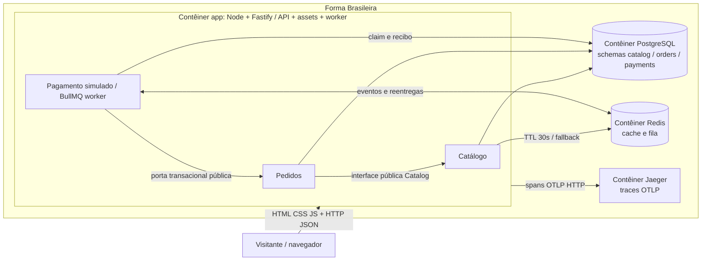

# C4 — contêineres executáveis

Vite é ferramenta de build; não é serviço em produção. O JavaScript (incluindo Three sob demanda) executa no navegador. Consumidor e API compartilham um processo no contêiner app. Não há Prometheus executável no Compose; `/metrics` expõe formato compatível para coleta futura.
