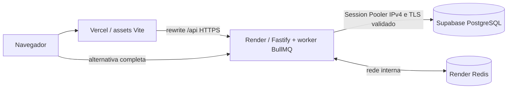

# Demonstração publicada — Vercel, Render e Supabase

## Endereços e verificação real

- **Galeria pública, sem login:** https://forma-brasileira.vercel.app
- **Backend e alternativa completa:** https://forma-brasileira-api-7fo6.onrender.com
- **Prontidão:** https://forma-brasileira-api-7fo6.onrender.com/ready
- Supabase: projeto `ygyvztysdjekemrujspf`, organização PedroGiffoni, us-east-1, plano free; custo consultado US$ 0/mês.
- Render: serviço `srv-dbqapq8u01pc73dqgcsg`, free, virginia; deploy `dep-dbqar62f0oos73f2a53g` observado **live**, revisão `dcd07e62b1fd4d379a8724cf8afbd0000529bf60`.
- Redis: `red-dbq9vd2jnfac73dab68g`, free, virginia, acesso interno e noeviction.

HTTP anônimo retornou 200 na vitrine e /ready. Catálogo retornou quatro peças. Pedido pela Vercel retornou 201 e R$ 1.530,00, com uma luminária e dois vasos. Seis requisições de pagamento do mesmo pedido terminaram em paid; SQL confirmou **um recibo e um registro de processamento**. Consulta remota confirmou **100.000 pedidos sintéticos e 100.000 itens sintéticos**; pedidos de testes ficam fora dessa contagem determinística.

Evidências: [smoke HTTP](evidencias/public-smoke.json), [infraestrutura, TLS e consultas](evidencias/publicacao/infra.json), [navegador público](evidencias/publicacao). As medições k6 anteriores são locais, não benchmarks do Render.

## Arquitetura



O navegador não recebe senha nem service_role. vercel.json preserva método/body/query de /api, evita cache da API e entrega HTML para URLs /pecas. Session Pooler IPv4 na porta 5432; DB_POOL_MAX=5. A API pública usa RUN_MIGRATIONS=false: tabelas foram preparadas como administrador a partir de scripts/migrate.ts. Compose local continua migrando automaticamente por padrão. Seed determinístico com SEED_DEMO_ORDERS=true.

## Credencial e TLS

O usuário aprovou o projeto free e a credencial restrita forma_app. Esse papel não é superuser, não cria bancos/roles nem recebe associação administrativa. Possui CONNECT, USAGE nos três schemas, SELECT/INSERT/UPDATE nas cinco tabelas e USAGE na sequência de itens. Sem DELETE. RLS nas cinco tabelas, políticas apenas para forma_app e schemas não expostos pela Data API. Advisor de segurança retornou zero avisos.

Primeiro deploy falhou com SELF_SIGNED_CERT_IN_CHAIN. Foi configurada a [CA oficial do painel Supabase](https://supabase-downloads.s3-ap-southeast-1.amazonaws.com/prod/ssl/prod-ca-2021.crt), válida até 26/04/2031: DATABASE_SSL=true, DATABASE_CA_CERT e rejectUnauthorized=true. Fingerprint em infra.json. Credenciais ficam no ambiente Render, fora do Git e das evidências.

## Reproduzir

```powershell
npx tsx scripts/verify-hosted.ts
$env:BASE_URL='https://forma-brasileira.vercel.app'
$env:EVIDENCE_DIR='docs/evidencias/publicacao'
npm run test:browser
```

Para recriar: criar um Supabase free, preparar as tabelas como administrador e conceder a um papel exclusivo as permissões acima; fornecer senha forte pelo ambiente protegido, sem versioná-la. Configurar Session Pooler e CA no Render. O render.yaml contém variáveis não sensíveis e relações; DATABASE_URL é fornecida separadamente.

**Gestão atual:** Vercel acompanha pushes de main. A API foi criada diretamente pelo conector após a falha do Blueprint; seu auto-deploy está **off**. Após CI verde, solicitar deploy manual da revisão desejada, aguardar live, conferir /ready e executar smoke. render.yaml é uma referência para nova instalação, não prova de sincronização ativa. Blueprint inicial exs-dbq9upijnfac73da9bu0 permanece pausado e associado ao Redis; revisar adoção/duplicação antes de sincronizar infraestrutura.

## Impedimentos resolvidos e limites

O banco Render foi recusado por “cannot have more than one active free tier database”; os-manager-test-db já ocupava a cota e foi preservado. O usuário autorizou Supabase; FoodSnap e MEMORA também foram preservados. Não houve upgrade pago.

Os planos gratuitos têm cotas. Render pode suspender a API por inatividade, causando espera na primeira visita; Redis perde mensagens/cache em reinício. Supabase free pode pausar por inatividade. Consultar/repetir pagamento pendente usando o mesmo pedido. Sem cobrança real, autenticação de compradores, estoque ou promessa de disponibilidade contínua.

A coleta remota de traces não foi configurada (OTEL_TRACES_EXPORTER=none); logs JSON e correlação continuam ativos. Evidências locais de Jaeger e k6 permanecem separadas.
